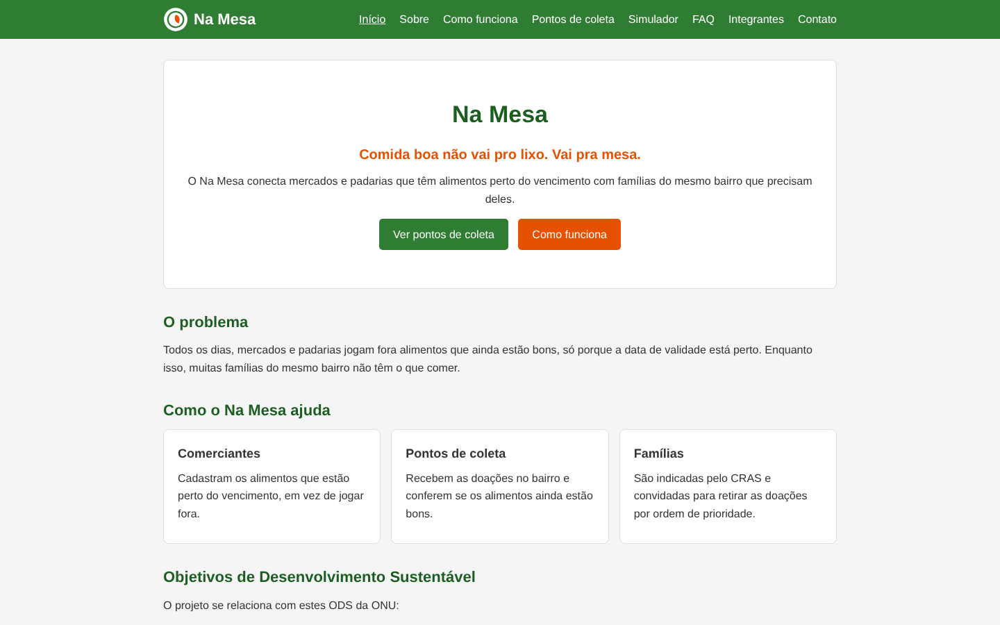
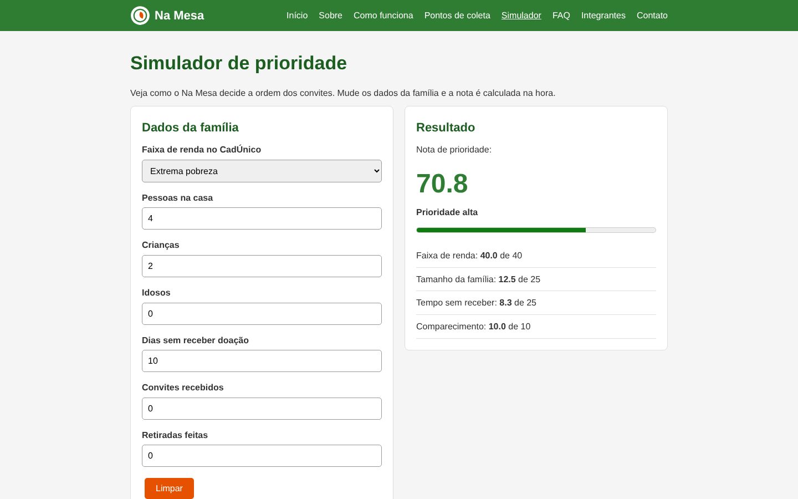
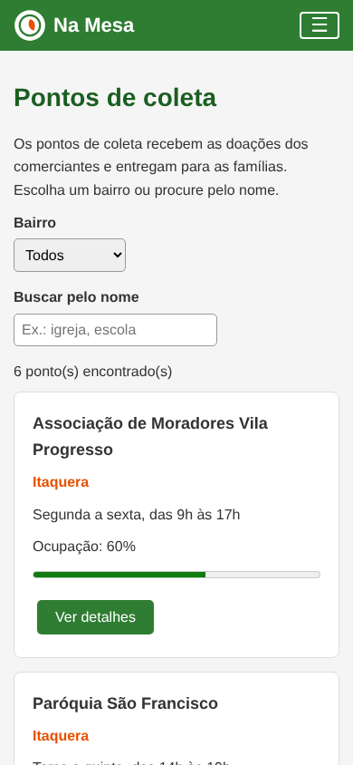

# Na Mesa

Site do projeto **Na Mesa**, feito para a Global Solution 2026/2 (CitizenTech) da FIAP, turma 1TDSPS.

- **Repositório:** https://github.com/eagu07/na-mesa

## Descrição

O Na Mesa conecta mercados e padarias que têm alimentos perto do vencimento a famílias do mesmo bairro que precisam deles. Os alimentos vão para pontos de coleta, e as famílias indicadas pelo CRAS são convidadas por ordem de prioridade (nota de 0 a 100: renda 40, tamanho da família 25, tempo sem receber 25, comparecimento 10).

ODS relacionados: 2 (Fome zero), 10 (Redução das desigualdades) e 11 (Cidades e comunidades sustentáveis).

## Tecnologias

- HTML5
- CSS3 (arquivo externo, mobile first, media queries em 768px e 1024px)
- JavaScript puro (sem frameworks nem bibliotecas)
- Git e GitHub

## Estrutura de pastas

```
na-mesa/
├── index.html
├── sobre.html
├── como-funciona.html
├── pontos.html
├── simulador.html
├── faq.html
├── integrantes.html
├── contato.html
├── README.md
├── css/
│   └── style.css
├── js/
│   └── script.js
└── assets/
    ├── icons/
    └── images/
        └── prints/
```

## Imagens do projeto





## Autores

| Nome completo | RM | Turma | GitHub | LinkedIn |
|---|---|---|---|---|
| Richard Henrique dos Santos Souza. | 576509 | 1TDSPS | [rhenrique013](https://github.com/rhenrique013) | [LinkedIn](https://www.linkedin.com/in/richardhenrique1312) |
| Diego Silva | 575925 | 1TDSPS | [Diegosilvadrs](https://github.com/Diegosilvadrs) | [LinkedIn](https://www.linkedin.com/in/diego-silva-drs) |
| Gustavo Andrade | 575971 | 1TDSPS | [eagu07](https://github.com/eagu07) | [LinkedIn](https://www.linkedin.com/in/gustavo-andrade-199429383) |
| Gustavo Rocha Batista | 570672 | 1TDSPS | [gustavo-rocha-batista](https://github.com/gustavo-rocha-batista) | [LinkedIn](https://www.linkedin.com/in/gustavo-rocha-batista) |
| Renato Zanchin Filho | 576199 | 1TDSPS | [renatozftv](https://github.com/renatozftv) | [LinkedIn](https://www.linkedin.com/in/renato-zanchin-0232563a2) |

## Contato

Pela página `contato.html` do site, ou pelo GitHub e LinkedIn de qualquer integrante (tabela acima).
